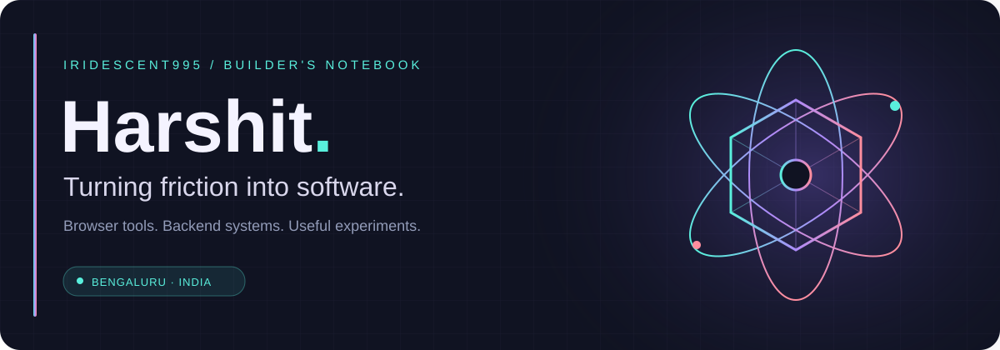
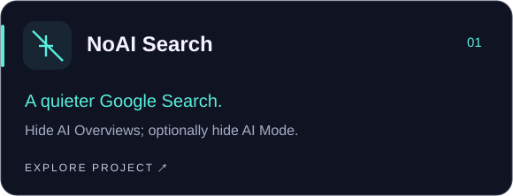
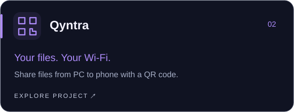
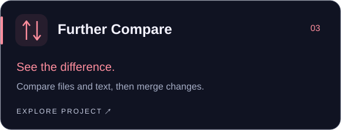
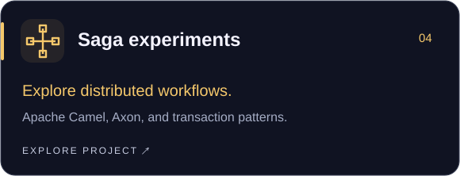

  

  
  
  

### A little about me

I'm Harshit, a developer in Bengaluru. I build small tools for everyday friction and explore the systems behind larger applications—from Chrome extensions and local file sharing to Java services and distributed workflows.

I like the part where an idea becomes something you can actually use.

### ◈ Selected builds

 

### ⌘ My workbench

  
  
  
  
  

**Interfaces & utilities** · Browser extensions, file tools, and workflow automation.  
**Backend & integration** · Java, Spring Boot, Apache Camel, and saga patterns.  
**Earlier explorations** · Ethereum, Hyperledger, bytecode manipulation, and games.

### ↗ From the notebook

**[I Used AI to Build an Off Switch for Google's AI](https://medium.com/@ht2995/i-used-ai-to-build-an-off-switch-for-googles-ai-ceac3527f55f)**  
On vibe coding, platform defaults, and building the choices you wish existed.

---

Notice the friction. Build the small thing. Make it useful.

